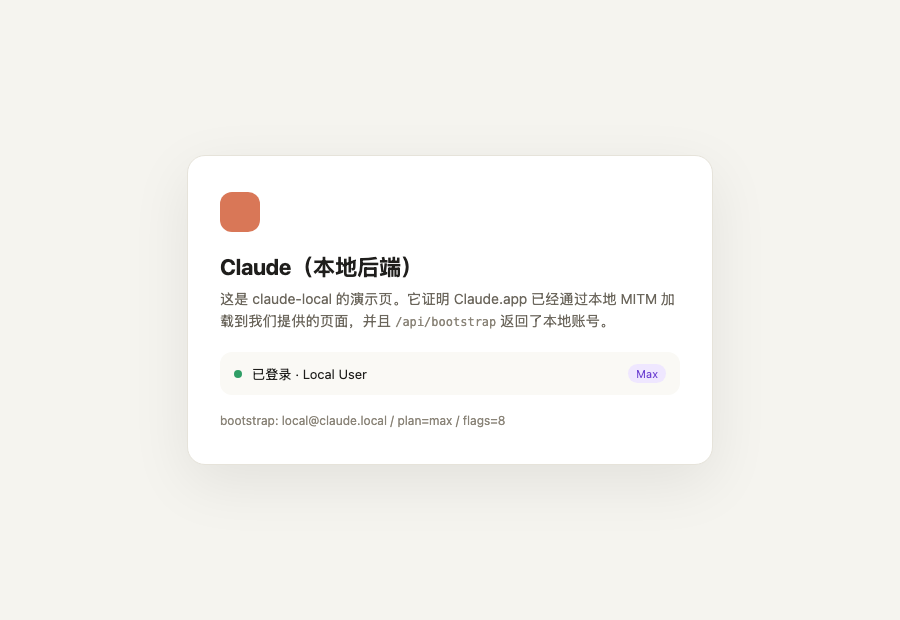
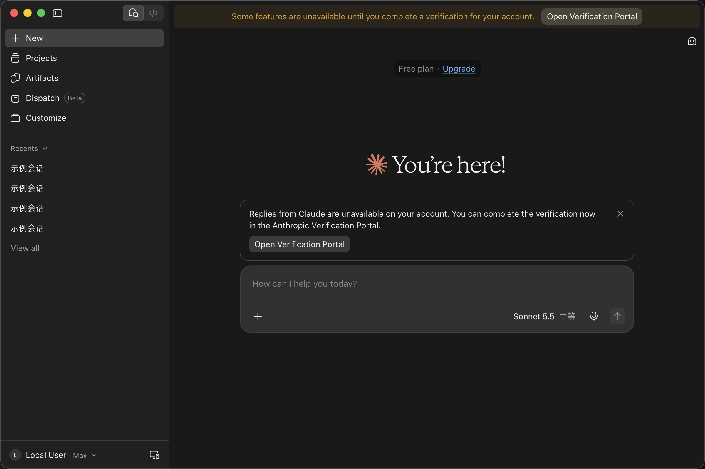

# claude-local: Claude Desktop Local Compatible Backend (PoC)

## Codex++ Managed Runtime

Managed mode uses the official Claude Desktop via `--proxy-server` to connect to the local service — no repackaging or modification of the Claude installer. Proxy, certificates, cache, and session data are managed by Codex++ in a dedicated state directory; normal official launches won't automatically get this proxy connection.

`CLAUDE_LOCAL_MANAGED=1` enables the managed protocol. Runtime only needs tracked Node modules and the English wordlist — it does NOT read the repo's `mock/`, local bootstrap recordings, recording wordlists, or `vendor/`. Web static assets still come from the official client and accessible upstreams; synthetic API data doesn't include private access tokens for dynamic resources. Managed mode serves the official SPA read-only from the current package; when localization is enabled, only `page-shim.js` (same-origin) is injected into the proxied HTML before the first official script runs, guiding the official frontend to adopt the English wordlist — no modification to Claude.app.

| Environment Variable | Purpose |
|---|---|
| `CLAUDE_LOCAL_GATEWAY_URL` / `_KEY` / `_MODEL` | Codex++ gateway root URL, local credentials, default model — required in managed mode |
| `CLAUDE_LOCAL_GATEWAY_MODELS` | JSON string array listing available provider/model IDs |
| `CLAUDE_LOCAL_GATEWAY_SMALL_MODEL` | Lightweight task model; falls back to default if not set |
| `CLAUDE_LOCAL_GATEWAY_MODEL_WINDOWS` | JSON object of per-model context windows (`{"provider/model": 1100000}`); bare model names also accepted |
| `CLAUDE_LOCAL_GATEWAY_DEFAULT_WINDOW` | Display/CLI window when selected model has no per-model declaration; defaults to Claude's own 200k assumption |
| `CLAUDE_LOCAL_WEB_I18N_DIR` | Full English wordlist bundled with app |
| `CLAUDE_LOCAL_CACHE_DIR` | Local proxy cache; dictation patches also write here |
| `CLAUDE_LOCAL_STATE_FILE` | Session and notification settings file; atomic write, `0600` perms |
| `CLAUDE_LOCAL_READY_FILE` / `_INSTANCE_ID` | This launch's ready receipt and instance identifier |
| `CLAUDE_LOCAL_LOCALIZATION` / `_VOICE_INPUT` / `_COMPUTER_USE` / `_BACKGROUND_MODE` / `_FORCE_BACKGROUND_MODE` | Independent capability toggles, `0` off / `1` on; last one ignores macOS version ceiling for background mode |
| `CLAUDE_LOCAL_COWORK` | Cowork master switch (GrowthBook `yukon_silver`), default on; `0` falls back to recorded template's own value |
| `CLAUDE_LOCAL_TEMPLATE` | Which recorded version the recording mode uses (`mock/<build>/` directory name = frontend build id); unset or deprecated falls back to latest (by page shell's `data-build-timestamp`) |
| `CLAUDE_LOCAL_HUB_HOME` | Only `1` recognized: use Claude's merged homepage (GrowthBook `claude_ai_hub_web_delivery`, Chat and Cowork in one input). Default uses classic homepage with "Chat | Cowork" toggle: turn off this switch and remove its code from `gated_imports` |

Managed launch supports `--port 0`; after listening, writes `{instanceId,pid,port,mode,lastClientAt}` receipt — no gateway credentials. `GET /__codex_claude_local/health` returns same identity and last client connection time; health polling doesn't update that time. Direct HTTP model requests require local gateway credentials and reject browser `Origin` requests; HTTPS official client path still handled by local interface.

Model selector's synthetic config comes from available model list; RPC `SendMessage.model` and `SetConversationModel` preserve actual selection; multi-turn chat sends completed history to gateway. Unknown native default models use configured default; fixed Haiku lightweight model uses lightweight task config. Proxy restarts resume sessions and notification prefs; interrupted replies marked complete, not auto-retried. Managed process saves state and closes listener on stdin EOF or `SIGTERM`.

Managed contract tests:

```bash
node --test tools/claude-local/managed.test.mjs
```

**Goal: No account, models via your own API, but client features complete.**

The approach isn't session forgery — it's **being the server yourself**:

```
Claude.app ──► Local CA + MITM(8899) ──► Static assets pass through to claude.ai (real UI)
                                        ├─ /api/*, /edge-api/* handled by local mock
                                        └─ /claudeai-rpc/* ConversationService
                                             └─ PerformAction(send_message) → record session
                                                StreamTimeline → update/append frames
                                                └─ Reply text ← Local model gateway SSE
```



> The screenshot above shows Chromium (same engine as Electron) opening `https://claude.ai/` via local proxy: CONNECT → TLS termination → `/api/bootstrap` returns local account → UI shows "Logged in · Max".

## Current Status (Verified)

| Capability | Status | Verification |
|---|---|---|
| Local CA + server cert | ✅ | `scripts/gen-ca.sh` |
| CONNECT + TLS termination (SNI) | ✅ | `scripts/test.sh` |
| `/api/bootstrap` fake account (plan=max) | ✅ | `curl --proxy + --cacert` returns JSON |
| `/api/organizations`, session list/create | ✅ | Same |
| Real Claude.app shows Local User · Max | ✅ | Live UI + `demo/app-loggedin.png` |
| `PerformAction` send_message → MutationAck | ✅ | Live, no retries, message renders |
| `StreamTimeline` update→append→complete | ✅ | Live streaming render (markdown) |
| Reply via local gateway (Anthropic Messages SSE) | ✅ | magpie @127.0.0.1:3425 live |
| New session / continue old session | ✅ | Both paths work |
| Demo page (verify Claude loads our page) | ✅ | `/` returns demo page |
| Install CA to keychain | ⚠️ Needs one manual auth | `scripts/install-ca.sh` |

### Current Network Can't Reach claude.ai

```
Direct claude.ai            → 302 /app-unavailable-in-region (geo-block)
Via Clash(7897) claude.ai  → 403 Cloudflare challenge
Real Chrome opens claude.ai → Cloudflare captcha page
```

So `mock` mode can't fetch real frontend assets (Claude on this machine is in the same state). **On a machine that CAN open claude.ai normally, run `--mode mock` to get "real UI + local account".**

## Quick Start

```bash
cd tools/claude-local

# 1) Generate local CA
sh scripts/gen-ca.sh

# 2) Install to keychain (one system auth prompt, click Allow)
sh scripts/install-ca.sh

# 3) Self-test (no Claude needed, no internet)
sh scripts/test.sh

# 4) Run demo: Claude loads local demo page, shows Max
sh scripts/run.sh demo

# 5) On a network that CAN reach claude.ai, run real UI + fake /api
sh scripts/run.sh mock
```

Claude launch args: `--proxy-server=http://127.0.0.1:8899`.

## Directory Structure

```
ca/                 Local CA + server certs (DO NOT COMMIT)
mock/bootstrap.json Local recorded account template (DO NOT COMMIT, may contain resource creds)
mock/api/conversations.json  Local recorded history template (DO NOT COMMIT)
demo/index.html     Demo page (proves the pipeline)
proxy.mjs           CONNECT + TLS + mock + upstream forward + routing
rpc.mjs             protobuf wire / Connect frames / message builders
conversation-service.mjs  ConversationService: StreamTimeline / PerformAction / fallback
scripts/gen-ca.sh   Generate certs
scripts/install-ca.sh / uninstall-ca.sh
scripts/run.sh      Start proxy + launch Claude
scripts/test.sh     End-to-end self-test
.cache/             Upstream static asset cache (written on passthrough)
```

On mock mode launch, dictation client from fixed-version Claude Electron cache is loaded, and local copy's normal dictation drain baseline extended to 125s; `thinkAloud` branch stays 60s. Patch only writes to `.cache/`, doesn't modify Claude app cache; stops on source version mismatch. Restore local copy:

```bash
node scripts/patch-dictation-drain.mjs --restore
node scripts/patch-dictation-start.mjs --restore
```

Same fixed-version dictation start patch limits dynamic module load to 15s, native start to 20s, `AudioContext.resume()` to 5s. Timeout cancels current start and releases audio context; late mic streams release along native generation check, UI returns to retryable state. Dev console `[Claude Local Dictation]` and `window.__codexPlusLocalDictationStatus` only log pending/connecting/recording/finishing/idle/error phases and status booleans — no transcript, audio, or session IDs.

Local WebSocket dictation starts a real interim transcription after 4s accumulated audio in current voiced segment; continues speaking → updates every 4s; detects 600ms pause or segment reaches 12s → commits segment text. `CloseStream` drains received audio; pure silence never triggers recognition or text generation. Each WebSocket session capped at 16min or 25MiB audio, whichever hits first stops it.

Generic HTTP transcription endpoint default timeout remains 120s — this doesn't mean WebSocket dictation waits for recording to end before recognizing. HTTP request timeout returns error first; client drain wait doesn't extend or retry that request. Mock mode launches with `--disable-http-cache` to ensure client reads that copy from local proxy; passthrough and demo don't apply this patch. Launch script aligns `CODEX_PLUS_STATE_DIR` to current manager instance: explicit env var first, then repo's `dist/local-build/Codex++.app` corresponding `dist/local-build/state`, finally falls back to `$HOME/.codex-session-delete`.

Source doesn't include locally recorded account/session templates and static cache; missing recordings fall back to built-in placeholder data. Real UI verification in this doc based on local recordings; full UI compatibility still depends on local interface data matching static assets.

## Mocked Endpoints

```
GET  /api/bootstrap
GET  /api/account
GET  /api/organizations
GET  /api/organizations/:org
GET/POST /api/organizations/:org/chat_conversations
GET  /api/organizations/:org/chat_conversations_v2   (static template + runtime session merge)
GET  /api/organizations/:org/chat_conversations/:uuid
POST /api/organizations/:org/chat_conversations/:uuid/completion   (SSE, old path, desktop no longer uses)
GET  .../usage | /limits
POST /claudeai-rpc/anthropic.bard.api.v1alpha.ConversationService/*  (Connect RPC, main path)
```

Fields are placeholder shapes based on public frontend code. **On a machine that CAN reach claude.ai, run `--mode passthrough` to capture real responses first**, then align item by item (same workflow Codex uses with `capture-account.mjs` to calibrate stubs).

## Rollback

```bash
sh scripts/uninstall-ca.sh   # Remove CA
# Quit Claude, open normally (no more --proxy-server)
```

## Boundaries

- No account forgery: Claude's identity lives server-side; client has no forgeable anchor.
- No touching Claude.app: Only install CA + proxy; upgrades unaffected.
- `/completion` needs third-party model output converted to claude.ai's SSE event sequence (skeleton exists; gateway integration is next step).
- Feature completeness depends on mock coverage; Computer Use needs frontend + local bridge protocol validation, not yet covered.

## Next Steps

1. Session persistence: CONV_STATE to disk (JSON), survive restarts;
2. Multimodal/tool calls: attachments, client_tools, elicitation schemas in descriptor, add as needed;
3. Gateway-side context: Currently only latest prompt sent per turn; later can concat conv.turns into messages history;
4. Computer Use / Cowork paths separate validation.

---

## 2026-11-07 Live Correction (Important)

Launching local Claude 4.16336.0 with `--proxy-server` revealed:

- Window is still **locally rendered** Cowork / Code UI, no `GET /` request;
- Only `POST /api/event_logging/v2/batch`, `POST /api/v2/rum` hit proxy;
- **This version of Claude Desktop's main UI is NOT the claude.ai web page** — `claude.ai` only serves some APIs + telemetry.

Corrected conclusions:

| Previous Assumption | Reality |
|---|---|
| Desktop main UI = remote claude.ai web page | ❌ Locally rendered |
| Need to mirror real UI to work | ❌ Not needed |
| Fake `/api/bootstrap` makes UI show Max | ❌ Local UI doesn't read account from bootstrap |

Therefore tool's value scope narrows to:

- ✅ Proves "local CA + MITM + fake API" pipeline works (verified);
- ✅ If future need arises to use web claude.ai surface, directly reusable;
- ❌ Can't unlock server-gated account features in local UI (Computer Use, Cowork, etc.).

Local UI's account state comes from app's own storage (`~/Library/Application Support/Claude-3p/`) and server endpoints, NOT claude.ai HTML.

---

## 2026-11-07 Milestone: Real Claude.app "Believes" It's Logged In



Config:
- `~/Library/Application Support/Claude-3p/claude_desktop_config.json` → `deploymentMode: "1p"`
- Remove `configLibrary/` (else app runs gateway onboarding)
- Launch: `open -a Claude --args --proxy-server=http://127.0.0.1:8899`
- Proxy: `node proxy.mjs --mode mock`

Result: Real Claude Desktop renders full chat UI, bottom-left shows **Local User · Max**, Projects / Artifacts / Dispatch / Customize all appear.

Data sources:
- Shell HTML: `capture.mjs` recorded from real browser
- Account structure: Logged into real account, captured `/edge-api/bootstrap`, sanitized to `mock/bootstrap.json`
- Interface shapes: `mock/api/*.json` (conversations / account_profile / skills / experiences, etc.)

### Restore Gateway Mode

```bash
cd ~/Library/Application\\ Support/Claude-3p
python3 - <<'PY'
import json; p='claude_desktop_config.json'; d=json.load(open(p)); d['deploymentMode']='3p'; json.dump(d,open(p,'w'),ensure_ascii=False,indent=2)
PY
mv /tmp/claude-configLibrary-live2 configLibrary   # If previously moved
```

---

## Chat Replies: Connect + protobuf (Working)

Live client replies don't use JSON `/completion` — they use Connect RPC over HTTP/1.1 chunked:

```
POST /claudeai-rpc/anthropic.bard.api.v1alpha.ConversationService/<Method>
Content-Type: application/connect+proto   (server-streaming)
Content-Type: application/proto           (unary)
```

Frame format: `[1B flag][4B big-endian length][protobuf]`, flag 0x02 = end frame (payload is JSON trailers).

Implementation in two layers:

- `rpc.mjs` — Hand-written protobuf wire encode/decode (no runtime) + Connect frames + all message builders used
- `conversation-service.mjs` — `ConversationService` dispatch: `StreamTimeline` (long-lived), `PerformAction` (send_message / stop_generation), `SendAndSettle`, `ReadConversation`, `ListConversations`, `StreamConversationList`, `GetNewConversationDefaults`, etc.

### Reply Pipeline

```
PerformAction(send_message)                StreamTimeline (long-lived)
  ├─ Parse ActionHeader.mutation_id            ├─ First frame: ConversationUpdate (running full snapshot)
  ├─ Parse SendMessage{message_id,             ├─ ContentBlockAppend frames × N (gateway SSE per delta)
  │   assistant_message_id, text, ...}        └─ Final frame: ConversationUpdate (complete + TurnDisposition=FINISHED)
  ├─ recordSend → conv.turns[] (idempotent, dedupe by humanId)
  ├─ ensureReply → anthropicStream(prompt) → Gateway /v1/messages SSE
  └─ PerformActionResponse{ack=1: MutationAck{high_water_mark, applied}}
```

### Pitfalls Hit (Live Corrections)

- `PerformActionResponse.ack` is **field 1**, not 4 (4 is corbel_edit_accepted). Wrong field → client never gets ack → mutation queue retries (same send_message sent 6 times).
- Server cert MUST be signed by `ca.pem` with subject ≠ issuer (same name treated as self-signed and rejected).
- `recordSend` MUST be idempotent by `message_id`, else client retries create duplicate turns.
- `ContentBlockAppend` only carries `text_delta`; full text fallback is final `ConversationUpdate`'s `ContentBlock.text` (client merges both).
- **List endpoints CANNOT return `{}`**: Client does `flatMap(p => p.items)` → produces `[undefined]` → render crashes `Cannot read properties of undefined (reading 'skill')` → fatal boundary ("This page ran into a problem" 0NV6PUA). Paginated endpoints need proper empty structure: `{items:[],data:[],next_cursor:null,has_more:false}`. `/oauth_tokens` needs top-level array, `/cowork_plugin_metadata` needs object dict — can't reuse pagination shape; see 2026-11-08 corrections below.
- `/i18n/*.json` upstream 302 to HTML → client parse error; switched to full local wordlist, `/s/` short IDs and `dynamic` wordlists handled separately (see 2026-11-08).
- **`activeOrganization` decides plan display**: bootstrap has null → UI shows "Free plan", Pro/Max models all locked "Upgrade", Code tab says "isn't included in your plan". Must set to org copy (with `rate_limit_tier`/`billing_type`/`subscription_management`).
- `org.capabilities=["chat"]` → Code/Cowork/Artifacts/Projects/Computer Use/Connectors disabled; add `claude_code`, `cowork`, `artifacts`, `projects`, `computer_use`, `connectors`.

### Gateway Config (Env Vars)

```
CLAUDE_LOCAL_GATEWAY_URL   Default http://127.0.0.1:3425   (magpie: Anthropic Messages compatible)
CLAUDE_LOCAL_GATEWAY_MODEL Default claude-sonnet-4-6
CLAUDE_LOCAL_GATEWAY_KEY   Default magpie                  (x-api-key / Bearer)
CLAUDE_LOCAL_DEBUG=1       Print PerformAction request fields (debug)
```

Session state in memory (`CONV_STATE`), proxy restart clears — acceptable for PoC; `/api/*/chat_conversations_v2` list merges runtime sessions into static template.

## Org Parsing / Join Flow Root Cause (Fixed)

Claude client at startup parses current org via `Mo()` (bundle `shared-l-p-m-w-4`): `preferredOrgUuid → existingOrgCookie → Zu()`. `existingOrgCookie` reads `lastActiveOrg` cookie (`M_(applicationType)` returns surface-scoped cookie name).

If cookie's org uuid doesn't match bootstrap memberships' org uuid, `/api/bootstrap/<uuid>/app_start` response can't match → `activeOrganization` empty → route guard redirects `/org-discovery` → "Join your team" → join → "Sent to admin".

Membership filter conditions (`shared-l-p-m-w-1`):
- `Ivo`: `organization.visibility_status` ∈ {active, pending, null}
- `Oi`: org `capabilities` MUST contain `iS(applicationType)`, claude-dot → `"chat"`
- `Jl`: desktop UA uses `preferNonHybrid`, filters out `taint:hybrid_3p` orgs

Fix: Delete `Application Support/Claude/Cookies` `.claude.ai` `lastActiveOrg` cookie, `claude_desktop_config.json` old org scope keys, Local/Session Storage leveldb logs.

## Code Mode Pipeline (Working)

- `lastActiveOrg` cookie (M_() returns cookie name per surface) stores old org uuid → Mo() org parse fails → /org-discovery join flow. Delete to fix.
- OAuth token exchange: `GET/POST {apiHost}/v1/oauth/{org}/authorize` + `POST /v1/oauth/token`, sessionKey cookie MUST have `Secure` (else "lacks httpOnly or Secure"). Authorize POST body has redirect_uri/state, response returns `{redirect_uri: "<rt>?code=...&state=..."}`.
- `downloads.claude.ai` geo-blocked → same verified version install can copy from another profile (e.g. Claude-3p/claude-code/<ver>/<bundle.checksum first 12>/), bundle.checksum matches app.asar embedded manifest → passes verification.
- Desktop CLI sends extra `diagnostics` field; strict-schema upstream gateways (ccbobi etc.) return 400. Proxy port 8899 also accepts plain HTTP, strips diagnostics/metadata.diagnostics before forwarding to magpie; `ANTHROPIC_BASE_URL` pointing to 8899 works. settings.json backed up as .bak-claude-local.
- Managed settings: `GET /api/claude_code/settings` → `{uuid,settings:{},checksum:"local-1"}`+ETag; `policy_limits` → `{restrictions:{},compliance_taints:[],defaults:{},artifact_create_notice:null}` (app.asar policy-limits validator requires `restrictions` non-null object, not array). Both claude.ai and 8899 direct paths need mock.
- `count_tokens` local estimate; `/v1/models` mock; `/v1/messages` forwards to local gateway.

## 2026-11-08: Code Managed Settings Warning Root Cause & Verification

`Remote managed settings failed to load (server response could not be parsed)` comes from embedded Claude Code 2.1.317, NOT Desktop's own settings fetcher. CLI response validation requires `{uuid:string, checksum:string, settings:record}` — previous mock missing `uuid`; Desktop only reads `settings`, so it logs `fetched (0 keys)` while CLI still parses fail. HTTP, claude.ai, and api.anthropic.com three paths now all return stable local `uuid`, preserving `content.entries` for Desktop's other endpoints.

Verification results:
- Real CLI binary diff: Old response errors `path:["uuid"]`, `parse_error` → warning; Just adding `uuid` → logs `Remote settings: Fetched successfully`, warning gone.
- Claude.app new Code session → "Connection OK.", no managed settings warning.
- No global `HTTPS_PROXY` modification or TLS verification disabled.

Also fixed `/v1/messages` prefix match: It was greedily catching `/v1/messages/count_tokens`, making local count branch unreachable.

Regression tests (generate local CA first, all tests run locally):

```bash
node --test tools/claude-local/proxy.test.mjs
```

Covers three settings paths CLI contract, real CONNECT/TLS validation, Desktop `content.entries` compat, auth instance list, plugin metadata dict, local token count, message diagnostics stripping.

### Code Settings Page Crash `1OFIM25`

Stack trace `(n ?? Ra).filter is not a function` from settings page auth instance list. Client directly calls `filter` on `GET /api/oauth/organizations/:org/oauth_tokens` response, so empty result MUST be top-level `[]`, not generic `{}` or `{data:[]}`. Added exact GET route; Real Claude.app reloads `#settings/claude-code` → full settings and "No connected Claude Code instances" empty state both display correctly.

Another live ZodError from `/cowork_plugin_metadata`: Requires plugin-ID-indexed object dict, empty should be `{}`, not pagination struct. Fixed and verified with real client validator.

### Language Selected But UI Still English

Language setting and bootstrap are `en-US`, issue was wordlist: `/i18n/s/en-US.json` fell back to app.asar's 825-item desktop shell wordlist, main UI's short IDs couldn't match. Now reuses repo `assets/claude-localization/catalogs/` full wordlist, layers local recordings and overrides; for `/s/` adds 6-char aliases per client's unique 10-char ID rule, preserves long IDs and existing short IDs. `/dynamic/` reads dynamic wordlist separately, no longer mixed with desktop shell entries.

Real Claude.app reload → sidebar, Code toolbar, input area, settings page all show English. Brand names and uncovered new copy may still retain original text.

### Local Account Identity Verification Prompt

Settings page receives empty `/api/organizations/:org/kyc_status` → treats missing status as incomplete verification. Local mock now explicitly returns `{status:"not_required",should_poll:false}`, native component hides prompt. Only modifies local simulated endpoint — no identity materials submitted, no changes to real account verification status.

### General, Account, Billing, Artifacts Page Crashes

Real client logs point to these response contracts — can't use `{}` as universal fallback:

| Page | Endpoint | Required Structure |
|---|---|---|
| General | `/api/organizations/:org/notification/preferences` | `preferences.feature_preference`, `effective_preferences`, `push_reachability` |
| Account | `/api/account/deletion-allowed` | `deletable:false,reasons:[],display_message:null` |
| Account | `/api/auth/trusted_devices` | `devices:[]` |
| Account | `/api/auth/mfa` | `mfa_enrolled:false,methods:[]` |
| Account | `/api/auth/sessions/list-active` | `data:[],pagination:{has_more:false,total:0}` |
| Billing | `/api/stripe/:org/invoices` | `invoices:[],next_page:null` |
| Artifacts | `/api/organizations/:org/user_artifacts` | `artifacts:[]` |
| Artifacts | `/api/organizations/:org/user_artifacts/count` | `count:0` |
| Artifacts | `/api/frame/frames`, `/api/frame/frames/external` | `frames:[]` |

Notification prefs support GET/PATCH, org-scoped, merged by feature+channel, preserves explicit `false` closes. Only stored in proxy process memory, resets on restart, no real notification subscriptions. Account deletion still closed; MFA only provides local mock account GET status, doesn't modify real account's 2FA.

Regression tests cover real CONNECT/TLS requests, concurrent first updates, invalid inputs, prototype property names.

## Computer Use Native Feature Entry

Native desktop's `/api/desktop/features` requires pre-evaluated GrowthBook `features` object. Plain boolean flags trigger `response body has no valid features object` → Computer Use judged `not_enabled`. Local mock only provides `1291166712` (chicago_config) with `value:{enabled:true,appScopedEnabled:true},on:true,off:false,source:"force"` — doesn't enable other experimental flags.

This response applies to local proxy's 1p desktop path; real 3p mode filters that remote flag. Client still checks platform, compliance limits, user `chicagoEnabled` pref, and real macOS accessibility/screen-recording permissions. No deployment mode changes, system permissions, or client binary modifications; no forged permissions. Entry available ≠ permissions configured or tool execution end-to-end verified.

Offline reuse of current client's original parsing, Zod validation, rollout functions: Old response `parse-error`, new `success` + rollout open; `chicagoEnabled=false` still doesn't enable actual execution. String `enabled:"true"` still rejected; expired config still invalid.

Background mode reads same config's `appScopedEnabled`; only `enabled:true` still shows "Your account hasn't enabled background mode". Adding it back makes native `computerUseAppScoped` pass; actual background tools controlled by this field too; client's system version and config validity checks preserved. User's `chicagoPreferredMode` untouched; current "Background/Full Control" selection still user-decided.

Real Claude.app refresh → Background option re-enabled from disabled, shows "Background" selected; Accessibility and Screen Recording still show granted. Not executing actual background ops via this check.

## Recorded Versions (mock-templates/)

Recorded UI data organized by frontend version: `mock-templates/<build>/` contains sanitized `bootstrap.json`, `api/*.json`, and same-recording page shell `shell.html`. Directory name MUST equal frontend build id (tests verify). `build.rs` embeds each directory into binary, installs to `<state>/claude-local/mock/<build>/`; User picks in Settings → Interface → Version, defaults to latest.

Frontend code (JS/CSS etc.) NOT bundled; fetched from `assets-proxy.anthropic.com` at runtime and cached.

Adding a new version (needs claude.ai login account, record once, everyone uses):

1. `open -na "Google Chrome" --args --user-data-dir=<temp> --remote-debugging-port=9447 https://claude.ai/login`, log in.
2. `node scripts/record-template.mjs --cdp http://127.0.0.1:9447 --out <private-dir>`
3. `node sanitize-mock.mjs <private-dir>/mock` → writes to `mock-templates/<build>/`
4. Verify no personal data remains (`cargo test -p claude-local embedded_mock_template_is_sanitized` checks email, then manual review of account uuid, org name), test, commit. Recording dir and temp Chrome profile deleted after.

Old versions kept; too old or unusable → delete directory.